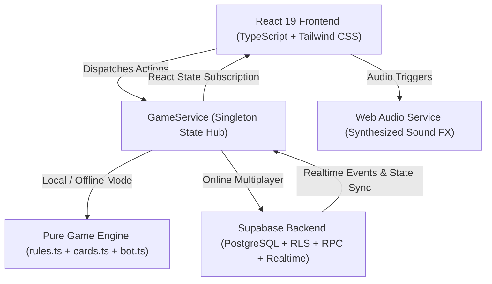

# 🌊 Naroom-opoly — Engineering Handover Notes

> **Project:** Naroom-opoly (NSW South Coast Edition Board Game)  
> **Repository:** `https://github.com/incanberra/Naroomopoly`  
> **Author:** Antigravity & USER  
> **Date:** October 2026  
> **Status:** Active / Feature-Complete Prototype  

---

## 1. Executive Summary & Goal

**Naroom-opoly** is a full-featured, responsive, multiplayer online board game set along the iconic Eurobodalla coastline on the NSW South Coast (from Batemans Bay down to Narooma and Montague Island / Baranguba).

The primary goal of this project was to faithfully implement standard Monopoly rules with local South Coast landmarks, Aussie humor, responsive mobile-first UI, robust offline bot gameplay, and real-time cloud multiplayer powered by Supabase.

Recent focus areas completed prior to this handover:
- **Game Pacing & Observability:** Prominent 3.5-second landing and turn action flash notifications with balance tracking, smooth bot pacing, and a 6-second auction hammer countdown.
- **Visual Overhaul:** High-definition tile art centerpieces, interactive pinned close-up deed inspection card, Fredoka (`font-board`) typography, and a cohesive coastal color theme.
- **Player Wealth Tracking:** Dynamic real-time Net Worth calculation and color-set monopoly completion progress dots (`● ● ○`) with golden crowns.
- **Design System:** Unified `rounded-3xl` modal dialogs with 3D perspective card flip animations.
- **Dynamic Feedback Effects:** Multi-stage confetti cannons (Passing GO, Free Parking Jackpot, completing a monopoly, winning) and dramatic Bodalla Police Station jail screen shake with emergency police siren strobe lights.

---

## 2. System Architecture & Tech Stack



### Core Technologies
- **UI Framework:** React 19, TypeScript 5.9, Tailwind CSS 3.4
- **Icons & Visuals:** `lucide-react`, custom SVG tokens, custom geometric procedural square illustrations
- **Animations & Effects:** Custom CSS keyframes (3D dice tumbling, card flips, token squash-and-stretch hops, jail shake, police strobe) + `canvas-confetti`
- **Audio:** Custom Web Audio API synthesizer (`src/services/audioService.ts`) producing authentic dice rolls, cash registers, jail door clangs, and card chimes without external MP3 assets
- **Backend / Realtime:** Supabase (`@supabase/supabase-js` v2.117) with anonymous authentication, PostgreSQL tables (`games`, `players`, `properties`, `game_events`), Row-Level Security, RPC functions, and Realtime Postgres Changes
- **Testing:** Vitest 5.0 with 32 unit tests verifying core engine and trade negotiations

---

## 3. Authoritative Directory & File Map

```
Naroomopoly/
├── .github/workflows/deploy.yml   # Automated GitHub Pages CI/CD workflow
├── supabase/migrations/
│   ├── 20261002000001_initial_schema.sql  # Database tables, RLS policies, realtime triggers
│   └── 20261002000002_game_functions.sql   # Server-side RPC transactions
├── src/
│   ├── App.tsx                     # Main application container, event router, theme & feedback FX
│   ├── index.css                   # Coastal color tokens, 3D animations, custom scrollbars
│   ├── data/
│   │   ├── boardData.ts            # ⭐ Single Source of Truth for all 40 tiles, rents, decks
│   │   └── tokens.ts               # Player tokens (Pelican, Kangaroo, Whale, Kombi, etc.)
│   ├── engine/
│   │   ├── rules.ts                # Pure functional Monopoly rule engine
│   │   ├── types.ts                # TypeScript interfaces (GameState, Action, Event, Phase)
│   │   ├── cards.ts                # Notice Board & Local Knowledge deck shuffling & handlers
│   │   ├── bot.ts                  # Bot AI decision tree (buying, building, auctions, trading)
│   │   └── __tests__/              # 32 unit tests (rules.test.ts, trade.test.ts)
│   ├── services/
│   │   ├── gameService.ts          # State synchronizer (switches between Supabase & local engine)
│   │   ├── supabaseClient.ts       # Supabase client instantiation & credential checks
│   │   └── audioService.ts         # Synthesized Web Audio sound effect engine
│   └── components/
│       ├── board/                  # Board, perimeter Tile, CornerTile, TileDetailCloseUp
│       ├── hud/                    # TopNav, ActionBar, PlayersPanel, EventLog, TurnActionFlash
│       ├── modals/                 # TitleDeedModal, ActiveCardModal, AuctionModal, TradeModal,
│       │                           # ManagePropertiesModal, RulesModal, GameOverModal
│       ├── lobby/                  # WelcomeScreen, LobbyScreen
│       └── icons/                  # TokenRenderer, custom SVG board illustrations
```

---

## 4. Key Decisions & Technical Rationale

1. **Single Source of Truth Configuration (`boardData.ts`):**
   - All property details, mortgage values, house costs, hardware store scales, utility multipliers, and all 32 action cards reside in `src/data/boardData.ts`.
   - Any non-programmer can adjust board names, rents, or card descriptions without touching React components or the engine.

2. **Graceful Local-First Fallback:**
   - If Supabase environment variables (`VITE_SUPABASE_URL`, `VITE_SUPABASE_ANON_KEY`) are missing or unconfigured, the app **never crashes**.
   - Instead, `gameService` automatically falls back to an in-memory local state runner, enabling complete single-player offline play against AI bots and hot-seat testing.

3. **Pure Functional Rule Engine:**
   - `applyGameAction(state, action, rng)` in `src/engine/rules.ts` is 100% deterministic and free of React or DOM dependencies.
   - This architecture allows comprehensive unit testing and makes migrating any rules into server-side PostgreSQL stored procedures trivial.

4. **Bot AI Pacing:**
   - When playing against bots, actions are sequenced with asynchronous delays (e.g. 1500ms dice rolls, 3500ms card dismissals, 6s auctions) so human players can clearly observe every move and financial transaction.

5. **Pin-Zoom Card Inspection on Mobile & Desktop:**
   - Perimeter tiles feature enlarged graphic centerpieces. Clicking or tapping any square pins the deed preview to the center of the board, allowing players on touchscreens to comfortably read rent tables and descriptions before making decisions.

---

## 5. Test Suite & Quality Assurance

Naroom-opoly includes 32 automated tests running on Vitest:
- **Board & Rules (`rules.test.ts`):**
  - Rent calculations (unimproved, full color group double rent, 1–4 houses, hotel).
  - Hardware store rent scaling ($25 / $50 / $100 / $200).
  - Utility dice roll multipliers ($4\times$ single, $10\times$ pair).
  - Even building enforcement (must build evenly across monopolies).
  - Mortgage values and unmortgage fee (10% interest).
  - Salary on GO ($200) and Bodalla Police Station arrest on three consecutive doubles.
  - Bankruptcy resolution and property asset liquidation.
- **Trade Negotiation (`trade.test.ts`):**
  - Propose, counter-offer, cancel, accept, and decline cycles.
  - Cash and property transfer atomicity.
  - Bot trade evaluation heuristics.

### Verification Commands
```bash
# Run unit tests
npm test

# Type check whole project
npx tsc -b

# Lint codebase
npm run lint
```

---

## 6. Supabase Deployment & Environment

To configure cloud multiplayer:
1. Enable **Anonymous Sign-in** in the Supabase Authentication dashboard.
2. Run SQL migrations in order:
   - `supabase/migrations/20261002000001_initial_schema.sql`
   - `supabase/migrations/20261002000002_game_functions.sql`
3. Configure `.env`:
   ```env
   VITE_SUPABASE_URL=https://<your-project>.supabase.co
   VITE_SUPABASE_ANON_KEY=<your-anon-key>
   ```
4. For GitHub Pages hosting, set `VITE_SUPABASE_URL` and `VITE_SUPABASE_ANON_KEY` in GitHub Repository Secrets under **Settings -> Secrets and variables -> Actions**.

---

## 7. Roadmap & Future Expansion Ideas

- **WebRTC Zero-Server Mode:** Peer-to-peer data channels for serverless multiplayer without requiring a Supabase backend.
- **3D House & Hotel Models:** Integrating three-dimensional shacks using Three.js / React Three Fiber (`dog_house.glb`).
- **Soundscape Audio:** Adding ambient coastal waves, bellbirds, and ferry horns to enhance immersion.
- **Spectator Mode:** Allowing non-playing observers to watch live high-stakes matches.
- **Game History Replay:** Exporting and replaying historical matches step-by-step from `state.events`.

---

*Handover prepared for incanberra • October 2026*
